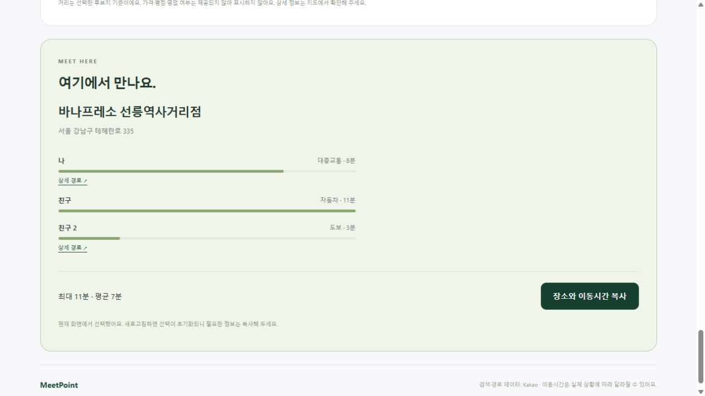

# MeetPoint 실제 API 연동 확인 — 2026-10-22

작업 폴더: `D:\WORKSPACE\PBL WorkSpace\MeetPoint` / 브랜치: `JJY`

## 결과

사용자가 MeetPoint 앱의 카카오맵 사용 설정을 켠 뒤, 기존에 발생하던 서비스 비활성화 오류가 해소되었다. 실제 카카오 API로 검색 → 경로 → 추천 → 주변 장소 → 최종 장소 경로 재조회까지 대표 시나리오를 확인했다. 코드 수정 없이 기존 구현으로 성공했다.

카카오 계정의 월렛·무료 쿼터 표시·잔여량은 직접 확인하지 않았다. 유료 사용 설정이나 계정 설정 변경은 수행하지 않았다.

## 실제 API 확인

검증 시작 시각: 2026-10-22 22:22 KST. 아래 시간은 조회 당시 예상값이며 교통 상황과 조회 시점에 따라 달라진다.

| 항목 | 확인 결과 |
| --- | --- |
| 장소 검색 | 강남역·양재역·선릉역·부산역 각각 검색 결과 10건 반환 |
| 대중교통 | 강남역 2호선→양재역 3호선 약 8.9분 |
| 자동차 | 같은 구간 약 10.0분 |
| 도보 | 같은 구간 약 27.5분 |
| 주변 장소 | 양재역 반경 1km 음식점·카페 각각 15건 반환 |
| 후보 추천 | 강남역(대중교통)·양재역(자동차)·선릉역(도보) 조합에서 후보 6곳 모두 계산 성공. 첫 후보는 선릉역 수인분당선 |
| 최종 장소 재조회 | 하우 양재역점까지 세 교통수단 모두 성공 |

[API 검증 결과 JSON](validation/2026-10-22-live-api.json)에 공개 장소명과 계산 결과만 기록했다. 키나 인증 헤더는 포함하지 않는다.

## 실제 화면 확인

`/planner`에서 세 참가자의 실제 출발지를 검색·선택하고 대중교통·자동차·도보를 각각 지정했다. 추천 실행 후 후보 6곳의 시간과 순서를 확인하고 음식점에서 카페로 전환했다.

바나프레소 선릉역사거리점을 선택해 경로를 재조회한 뒤 `이 장소로 선택`까지 완료했다. 화면 표시값은 대중교통 8분, 자동차 11분, 도보 3분이며 최대 11분·평균 7분이다. 화면은 표시용 올림/반올림을 사용하므로 계산용 원래 값과 차이가 있을 수 있다. 해당 흐름에서 수집된 브라우저 경고·오류 로그는 없었다.

## 이전 검증과 이번 검증의 구분

- 2026-10-21: 정적 검사, TypeScript 검사, 단위 테스트 18개, 프로덕션 빌드 통과. 데스크톱·모바일 배치와 응답 대역을 사용한 취소·오류·선택 흐름 확인.
- 2026-10-22: 실제 API 및 실제 응답을 사용한 데스크톱 브라우저 흐름 확인. 애플리케이션 코드는 변경하지 않았고 검증 기록과 안내 문서를 갱신했다.
- 이번 확인은 대표 출발지 조합에 대한 결과다. 전국 모든 구간, 도시간 대중교통, 장거리 도보, 모든 인원 조합의 실제 성공을 보장하는 검증은 아니다.

## 팀원 연결 및 남은 범위

프론트 담당자는 [API 계약 문서](JJY_LOCATION_API.md)의 검색·추천·주변 장소·최종 경로 API를 메인 화면에 연결할 수 있다. 기존 메인 화면(`/`)은 예시 데이터 화면으로 유지했다.

현재 `/planner`는 조회 시점 기준 이동시간을 제공한다. 미래 약속 시각 예측, 가격·평점·영업 여부 필터, 영구 저장, 로그인·계정 연동은 이번 구현에 포함되지 않는다. 새로고침하면 화면의 선택은 초기화된다.

이번 변경은 로컬 `JJY`에 저장되어 있고 커밋·푸시는 수행하지 않았다. `.env.local`은 Git 제외 상태를 유지한다.
